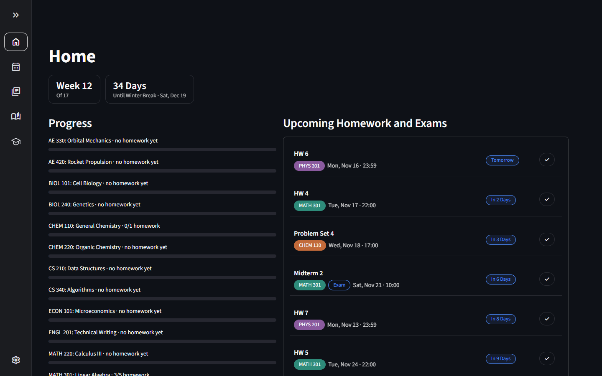
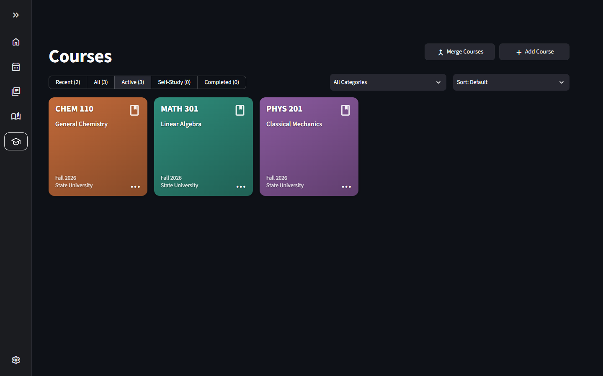
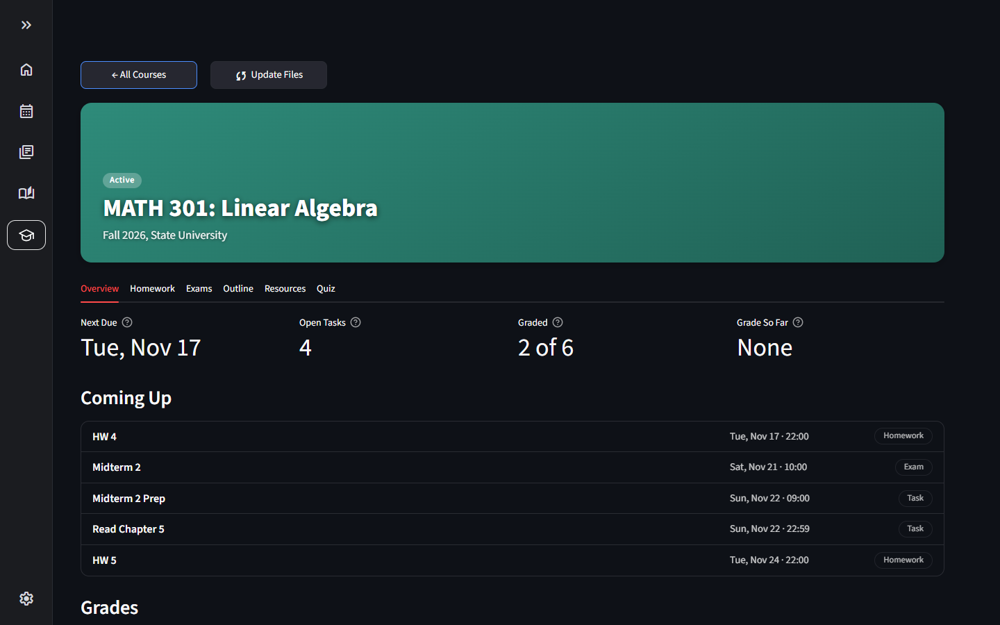

# Study Assistant

Version 1.0.2. See the [changelog](#changelog) below for what changed in each release.

**A personal study desk for university coursework.** Keep a course's textbooks, lecture slides, notes, homework and exams in one library, read them side by
side, and let the app keep track of deadlines, grades and outlines. It runs entirely on your computer, in its own desktop window; nothing is sent anywhere.

## Main features

- **Course library.** Import PDFs and HTML pages (textbooks, lecture slides, notes, homework, exams, syllabi) and sort them by course and lecture. Imports are copies;
  your originals are never changed.
- **Note Reader.** Interactive HTML notes with tabs for the notes, mind map, equation sheet, assumptions, quiz and errata, next to a PDF window. Click an equation
  or a source line and the matching slide or textbook page opens.
- **PDF reader.** Single, double or continuous pages, zoom and drag to move, search, and pen or highlighter drawing that is saved with the file.
- **Homework and exams.** Written helper and grade-explanation pages shown beside the problem or graded paper, with Gradescope grade reports, exam preparation
  pages and a place for what is due.
- **Courses and outlines.** Each course has deadlines, homework, exams, resources and a quiz. The outline builds itself from the syllabus or the lecture titles and
  can be edited as plain text.
- **Calendar and Home.** The weekly class schedule, holidays and exam period, and a Home page with what is due next and the week of the term.
- **Quizzes and eye rest.** Quizzes from your notes with scores kept per chapter, and a reminder to rest your eyes every 20 minutes.
- **Backup and moving.** Automatic snapshots, a library backup in a folder you choose, and Export My Files / Import to keep a copy or take everything to another
  computer.

## Gallery

(With made-up courses and files.)

<table>
  <tr>
    <td> <b>Home</b>: what is due next and the week of the term</td>
    <td> <b>Calendar</b>: the class schedule with deadlines and exams</td>
  </tr>
  <tr>
    <td> <b>Courses</b>: one card for each course, by status</td>
    <td> <b>Course page</b>: homework and grades, exams, outline, resources and a quiz</td>
  </tr>
  <tr>
    <td> <b>Note Reader</b>: click an equation and its source slide opens beside the note</td>
    <td> <b>Library</b>: slides, notes and textbooks sorted by course</td>
  </tr>
  <tr>
    <td> <b>Course outline</b>: built from the syllabus or the lecture titles, and editable</td>
    <td> <b>Backup</b>: library backup, Export My Files and Import</td>
  </tr>
</table>

## Keyboard shortcuts

| Key | What it does |
| --- | --- |
| **F2** | Saves a screenshot of the app window in `%APPDATA%\Study Assistant\screenshots` |
| **F5** | Refreshes the page with fresh data and keeps your place (**Ctrl + F5** loads the whole page again) |
| **F11** | Full screen on and off |
| **h**, **a**, **l**, **n**, **c**, **s** | While the menu bar is shown: opens Home, Calendar, Library, Note Reader, Courses or Settings |
| **m** | Hides the menu bar, or shows it again (point at the left edge to peek at it); the key can be changed in Settings |
| **Ctrl + F** | Finds text in the note or PDF under the pointer |
| **Ctrl + mouse wheel** | Zooms the PDF reader (drag the page to move it) |
| **d**, **p**, **h**, **e**, **Ctrl + Z** | Drawing mode, pen, highlighter, eraser and undo in the PDF reader |

Settings > Keyboard Shortcuts lists the keys that can be changed.

## Download and install

Get the download for your computer from the [Releases](../../releases) page. Study Assistant is installed for your user only (no administrator needed), and your files are kept
apart from the program, so updating or reinstalling never touches them.

### Windows 10 and 11

Download `StudyAssistant-<version>-Windows-Installer.zip`, extract the whole zip, and run `Install Study Assistant.exe` from the extracted folder (keep the `payload` folder next
to it). The setup wizard guides you:
- **If Study Assistant is already installed**, it tells you which version and offers to **update (overwrite)** it, to **uninstall the older version first**, or to **keep both**
  (it warns that both share one data folder and one address, so only one should be open at a time).
- **Shortcuts:** you choose a Desktop shortcut and / or a Start menu entry. Study Assistant is also listed under Settings > Apps, where it can be uninstalled (your files are
  kept unless you choose to remove them).
- The last page links to this page and its [Help](#help) section.

### macOS (Apple silicon and Intel)

Download `StudyAssistant-<version>-macOS-Apple-Silicon.dmg` (M1 and newer) or `StudyAssistant-<version>-macOS-Intel.dmg`, open it, and drag **Study Assistant** onto the
**Applications** folder. If it is already there, choose **Replace** (your files are kept) or **Keep Both**. The first time, right-click (or Control-click) the app in Applications,
choose **Open**, then **Open** again; if macOS still blocks it, use System Settings > Privacy & Security > **Open Anyway**. The Mac app is built by GitHub from this repository
(see `.github/workflows/build-macos.yml`).

> **Your antivirus, Windows SmartScreen or macOS may warn about the app, or block it.** It is a false alarm: **Study Assistant does not contain a virus**, and the whole source code
> is here to read. Programs that are new and not code-signed are often flagged until many people have run them. If it blocks the file, choose "More info > Run anyway"
> (Windows SmartScreen) or "Open Anyway" (macOS), or allow the file in your security software. Only download it from the [Releases](../../releases) page, and check the file against
> the SHA-256 checksum published next to it (`SHA256SUMS.txt`): in PowerShell `Get-FileHash <file>`, on a Mac `shasum -a 256 <file>`.

The app starts empty; add your own courses and files.

## Where your files go

Everything you add (database, settings, imported PDFs and notes, covers, photos, drawings) is kept in `%APPDATA%\Study Assistant` on Windows and in
`~/Library/Application Support/Study Assistant` on a Mac, created empty on first run. Imports are always copies; your original files are never changed or deleted.

## Backup and moving to another computer

Settings > Backup keeps a copy of your library in a folder you choose and can bring it back. **Export My Files** makes one zip with your database, settings and
imported files, to keep as a backup or to take to another computer: install Study Assistant there, open Settings > Backup > Import and choose the zip. Nothing is
deleted: a file that is already there and differs is copied aside first.

## Help

**How do I install or update it?** See [Download and install](#download-and-install). The Windows setup wizard detects an installed version and offers to update it, to uninstall it
first, or to keep both. On a Mac, drag the app over the old one and choose Replace.

**Windows or my antivirus warns about the app.** It is a false alarm (see the note under Download and install): choose *More info > Run anyway*, or allow the file. On a Mac,
right-click the app and choose *Open*.

**Where are my files?** `%APPDATA%\Study Assistant` on Windows, `~/Library/Application Support/Study Assistant` on a Mac. Updating or reinstalling never touches them.

**How do I back up, or move to another computer?** Settings > Backup keeps a copy of your Library; *Export My Files* makes one zip, and *Import* on the other computer brings it
back (a Windows export can be imported on a Mac and the other way round).

**The window says "Connection error" or stops responding.** Close it and open Study Assistant again; your files are safe. The installed app keeps a log in the `logs` folder of the
data folder: include its last lines when you report the problem.

**The function keys do nothing on my Mac laptop.** Hold the **fn** key with F2, F5 and F11, or turn on "Use F1, F2, etc. keys as standard function keys" in System Settings.
Screenshots (F2) ask for the Screen Recording permission the first time.

**How do I uninstall it?** Windows: Settings > Apps > Installed apps > Study Assistant > Uninstall (it asks whether to keep your files). Mac: drag the app from Applications to the Bin.

**Something is not working, or I have an idea.** Open **Settings > Report an Issue** in the app: it opens a ready-made report on GitHub (you read it and press Submit; the app sends
nothing by itself). Or [open an issue](../../issues/new/choose) here. A free GitHub account is needed, and issues are public, so leave out anything personal.

## Changelog

The full history is in [CHANGELOG.md](CHANGELOG.md).

**1.0.2** (not released yet)
- **Study Assistant for macOS** (Apple silicon and Intel): a disk image to drag into Applications; files in `~/Library/Application Support/Study Assistant`.
- **New setup wizard** for Windows: sharp on high-resolution screens, with a welcome page, the choice to update, uninstall first or keep both when it finds an installed version,
  Desktop and Start menu shortcut options, an antivirus heads-up, and a last page with links to this page and its Help section.
- **Loading screen with a progress bar** from 0% to 100% that shows for at least two seconds.
- **Help and Report an Issue** in Settings; the report opens a ready-made GitHub issue.

**1.0.1** (2026-11-15)
- F2 saves a screenshot of the app window; F5 refreshes the page; F11 turns full screen on and off.
- Press m to hide the menu bar (point at the left edge to show it); Settings has a switch and a key box for it. While the menu bar is shown, a letter opens a page (h Home, a Calendar, l Library, n Note Reader, c Courses, s Settings).
- The Exams tab of a course shows the Preparation page for past exams too.
- Equation sheets can be built for past exams too (every exam of the course is listed on the Exams tab).
- Course quizzes: choose Check After Each Answer (marked and explained right away) or Check After Finishing (marked at the end).
- A finished quiz can be opened again with View (score, your answers, explanations); every attempt is kept until you choose Clear Attempt History.
- Quiz options are shuffled for every attempt, so the right answer is no longer usually the second one.
- A running quiz can be saved with Save For Later and resumed from the quiz list.
- A course made of several courses (such as Differential Equations from MA 266 and MA 303) has a switch above its tabs to show one part at a time, or all.

**1.0.0**
- First release. Clean installs start empty; an installer that registers an uninstaller (keep or remove your files).
- Backup, Export My Files and Import, to protect your files and move them to another computer.
- Course outlines build themselves from the syllabus topics (or the Lec 0 slides), otherwise from the lecture or chapter titles, and can be edited as text.
- PDF reader zoom and pan in every view mode; equation and source-line clicks in the Note Reader open the matching slide or textbook page.
