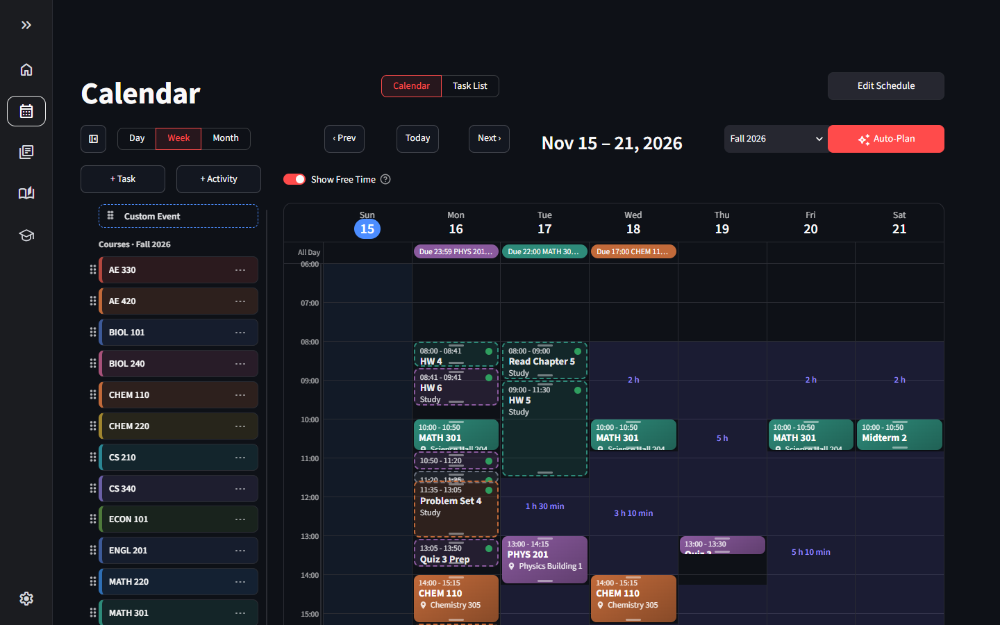
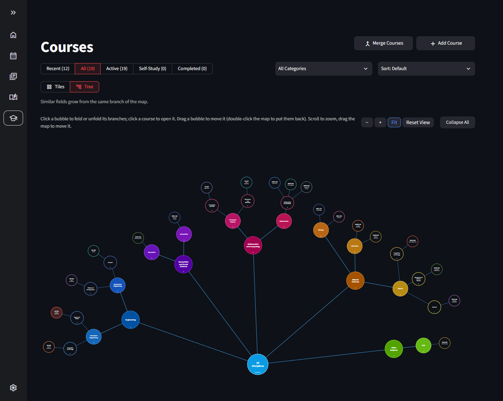
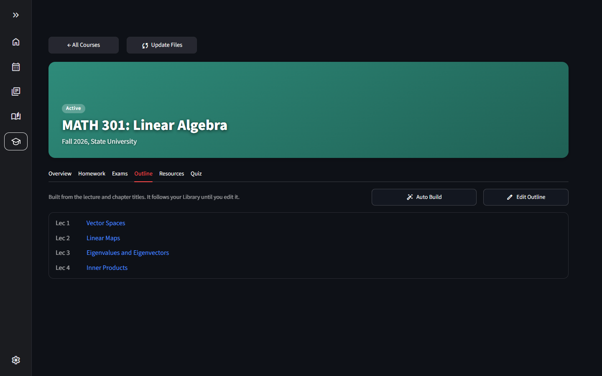
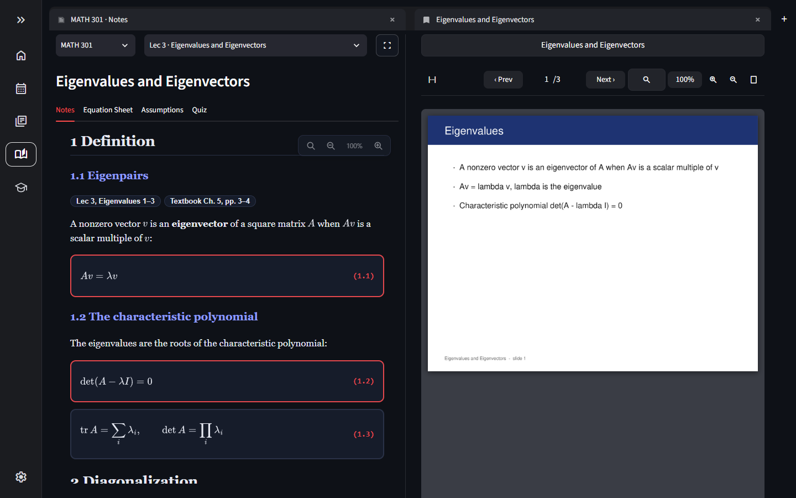
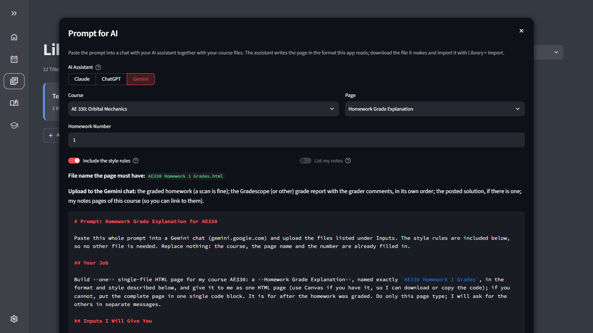
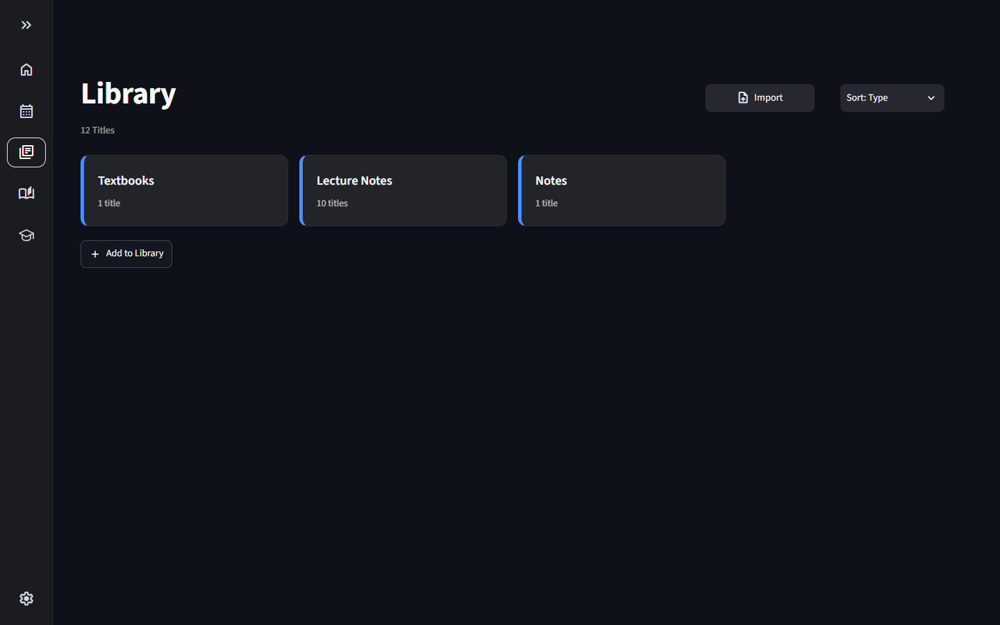
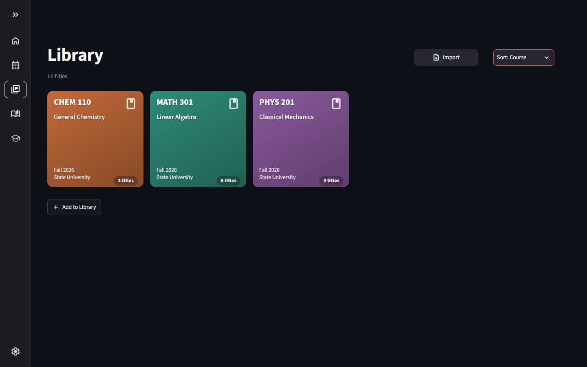
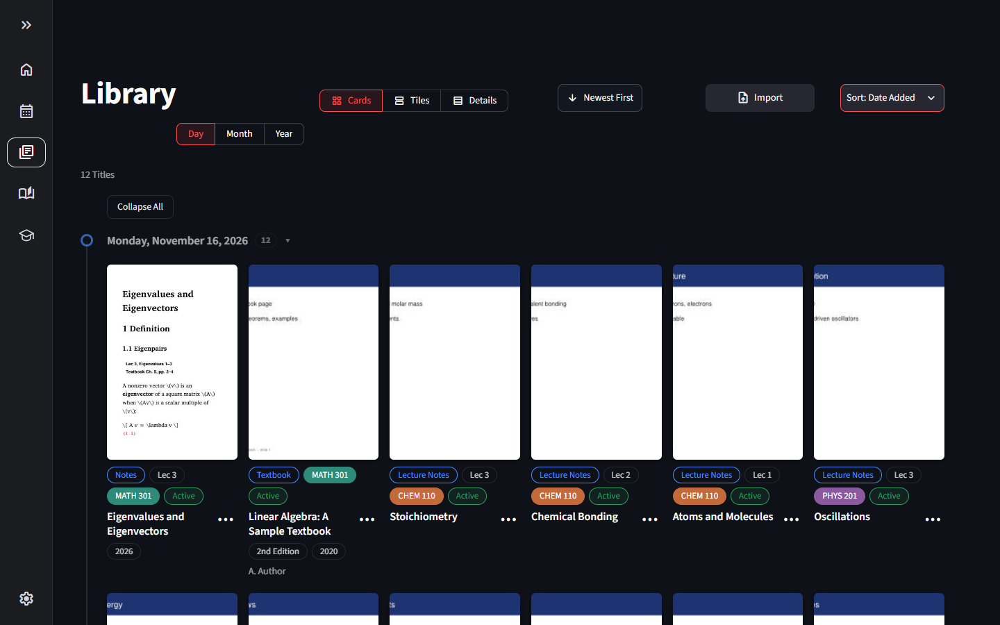
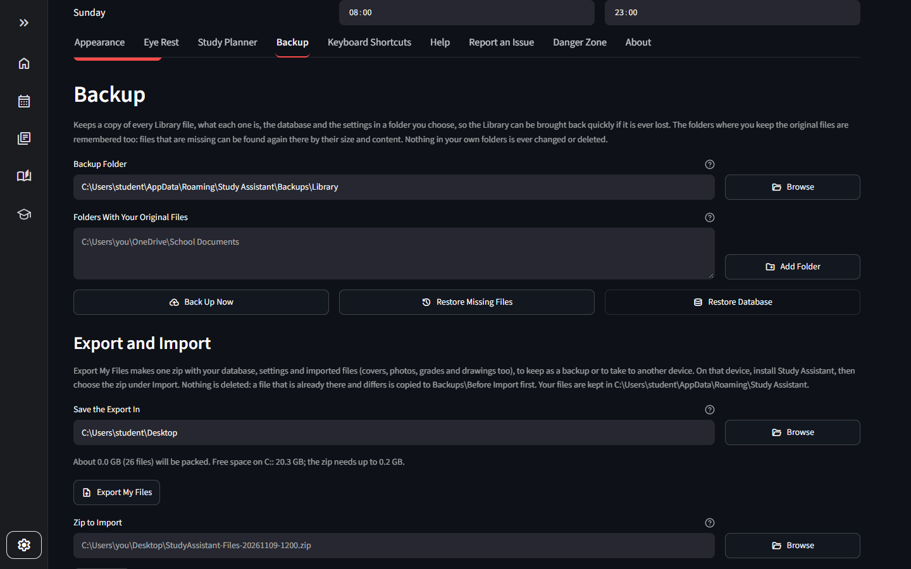

# Study Assistant

<b>Overview</b> &nbsp;|&nbsp; <a href="docs/INSTALL.md">Install</a> &nbsp;|&nbsp; <a href="docs/FILES.md">Your Files</a> &nbsp;|&nbsp; <a href="docs/SHORTCUTS.md">Shortcuts</a> &nbsp;|&nbsp; <a href="docs/HELP.md">Help</a> &nbsp;|&nbsp; <a href="CHANGELOG.md">Changelog</a>

---

Version 1.1.3. See the [changelog](CHANGELOG.md) for what changed in each release.

**A personal study desk for university coursework.** Keep a course's textbooks, lecture slides, notes, homework and exams in one library, read them side by
side, and let the app keep track of deadlines, grades and outlines. It runs on your computer, in its own desktop window, and your files, notes and grades stay there. The app goes online only for three things: **Import From Calendar** reads the calendar link you give it (and reads it again when the app opens, which you can turn off), notes with math load the MathJax library from the jsDelivr CDN when you open them, and **Report an Issue** opens a pre-filled GitHub page in your browser, which sends nothing until you press Submit there.

## Main features

- **Course library.** Import PDFs and HTML pages (textbooks, lecture slides, notes, homework, exams, syllabi) and browse them by type or by course (tiles), by the day, month or year they were
  added (a timeline that folds), or by title, as cards, tiles or a details table. Add files one by one, from a zip (after a confirmation page), or by pressing Update to read the folder you keep them in. Imports are copies; your originals are never changed.
- **Note Reader.** Interactive HTML notes with tabs for the notes, mind map, equation sheet, assumptions, quiz and errata, next to a PDF window. Click an equation
  or a source line and the matching slide or textbook page opens.
- **PDF reader.** Single, double or continuous pages, zoom and drag to move, search, and pen or highlighter drawing that is saved with the file.
- **Homework and exams.** Written helper and grade-explanation pages shown beside the problem or graded paper, with Gradescope grade reports, exam preparation
  pages and a place for what is due.
- **Courses and outlines.** Each course has what is coming up, homework, exams, resources and a quiz; the All tab can also show the courses as a tree of knowledge, with similar fields on the same branch. The outline builds itself from the syllabus or the lecture titles and
  can be edited as plain text.
- **Calendar and Task List.** A weekly (or day, or month) schedule with your classes, activities, events, deadlines and study sessions; blocks of courses, tasks and activities on the left
  to drag into the schedule, with a menu to rename, color, hide or delete each one. The Task List page shows every task by course, grouped and sorted by any column, and **Import From
  Syllabus** reads the homework, quizzes and exams of each course of the term (from its course page and its syllabus) into the list, to check and change. Terms (semesters) are
  chosen and managed from the list above the calendar, and Home shows what is due next.
- **Study planner.** Tasks have a due date and a time estimate, and the Calendar shows how much free time is left before each deadline (a green, yellow or red cushion), warns when work does not fit, and
  places study sessions for you around classes, activities and events (with travel time); drag sessions and events to change them. Personal tasks can be planned in a break too.
- **Getting started and calendars.** New students get a short checklist on Home (it can be skipped). **Import From Calendar** brings in the assignments and events of Canvas, Brightspace,
  Google Calendar and Shovel from a calendar link (kept up to date) or an `.ics` file.
- **Prompts for your own AI.** Library > Import > **Prompt for AI** writes a ready-to-paste prompt for **Claude, ChatGPT or Gemini** for a study guide, a homework
  helper, a grade explanation, an exam reflection or an exam preparation page, with the format this app reads built in; download the page the assistant makes and import it.
- **Quizzes and eye rest.** Each chapter has up to three quizzes from your notes: conceptual questions, a timed 90-second speed round and guided numerical practice (step by step, with the reason for every option). They are taken separately and their scores count together in a total per chapter, kept even when a note is replaced. A reminder to rest your eyes every 20 minutes.
- **Backup and moving.** Automatic snapshots, a library backup in a folder you choose, and Export My Files / Import to keep a copy or take everything to another
  computer.

## Under the hood

- **Stack:** Python with [Streamlit](https://streamlit.io) for the pages, SQLite for the data, [pywebview](https://pywebview.flowrl.com) for the desktop window, PyMuPDF and pypdf for PDFs, Pillow and pillow-heif for images (`requirements.txt`).
- **Folders:** `core/` the database, queries and settings; `library/` file details, covers, naming, merge and outlines; `study/` notes, quizzes, equation sheets, errata and the PDF reader; `planner/` the study planner
  (its scheduling logic is pure Python with no database or UI, so it is easy to test); `views/` every page; `datafiles/` backup, export and import; `desktop/` the screenshot, folder picker and help; `tools/` the build scripts and the installer.
- **Your data is kept apart from the program:** the database and your files live in a data folder in your user profile, so updating or reinstalling never touches them.
- **Packaging:** PyInstaller builds the Windows app, and `tools/installer.py` is a tkinter setup wizard (update, uninstall or keep both versions, shortcuts, an uninstaller). On a Mac, `tools/build_mac.py` builds an app and a disk image.
- **CI:** `.github/workflows/build-macos.yml` builds the Apple Silicon and Intel disk images when a release is published, starts each built app to check it answers, and attaches the images and their SHA-256 files to the release.
- **Tests:** 743 tests in 40 files (`python -m pytest`), run against a temporary data folder, never the real one.

## How it was built

It was developed with Claude in VS Code. The project's standing rules for the assistant (what lives where, how to protect the user's data, the file formats the app reads, the interface conventions) are written down in [`CLAUDE.md`](CLAUDE.md),
including writing tests with every phase of work (see above).

## License

Copyright (c) 2026 Ethan Lee. Study Assistant is free software under the [GNU Affero General Public License, version 3](LICENSE): you may use, study, change and share it under those terms, and a changed version
you share must be shared with its source under the same license. The software it is built on, with its licenses, is listed in [THIRD-PARTY.md](THIRD-PARTY.md).

## Get it

- **Choose your computer** and follow its steps (the download is on the [Releases](https://github.com/Chiyami1213/study-assistant/releases) page):
  - **Windows 10 or 11:** [install on Windows](docs/INSTALL.md#install-on-windows-10-or-11)
  - **Mac with Apple silicon** (M1 or newer) or **Mac with an Intel processor:** [install on a Mac](docs/INSTALL.md#install-on-a-mac), which also shows how to tell which Mac you have
  - Not sure? [Choose your device](docs/INSTALL.md#choose-your-device)
- Your antivirus, Windows SmartScreen or macOS may warn about the app: **Study Assistant does not contain a virus** (see the note on the Install tab).
- **Check your download (optional):** every release has a `SHA256SUMS.txt` with the fingerprint of the file. In PowerShell run `Get-FileHash <file>` (on a Mac `shasum -a 256 <file>`); if the result equals the
  line in the checksum file, the file is exactly the one published here. The Windows zip is checked against `SHA256SUMS.txt`; each Mac disk image has its own file,
  `SHA256SUMS-macOS-Apple-Silicon.txt` or `SHA256SUMS-macOS-Intel.txt`.
- Problems, questions or ideas: the [Help](docs/HELP.md) tab, or Settings > Report an Issue inside the app.

## Help

Questions about installing, antivirus warnings, your files, backups, shortcuts and connection problems are answered on the [Help tab](docs/HELP.md).

## What's new

**1.1.3**
- **Three quizzes for every chapter** in the course Quiz tab: conceptual questions, a timed speed round and guided numerical practice, taken separately and counted together in the chapter's total.
- **Home** also lists lab reports and projects; **Prompt for AI** follows the newest study guide rules.

**1.1.2**
- **Remove Files** in bulk (Library > Import), **Update From Folder** that finds newer versions of files you already have, and Done on Home and in the Task List kept in step.
- Left-aligned menus, and a tutorial that names Shovel and the Replace or Keep choice.

**1.1.1**
- **Color themes** (Settings > Appearance): Graphite (the original look), Ocean, Forest and Plum.
- **Clear Auto-Plan** removes the study sessions Auto-Plan made that have not started; **Safety Copies Folder** (Settings > Backup) lets you keep the app's own copies elsewhere, for example in OneDrive.
- **Smoother tour and imports:** the guided tour works with the arrow keys and its box no longer lags; Update From Folder and Import a Zip no longer shift the table while you tick files, and have
  Select All, Deselect All and Changed Only.
- A smaller download (about 40 MB less).

**1.1.0**
- **Getting started and calendars:** a **Getting Started** check chain and a guided tour for new students (a box and an arrow show where to click; it can be skipped and started again), and **Import From Calendar**: the assignments and events of Canvas, Brightspace and Google
  Calendar from a calendar link (kept up to date) or an `.ics` file.
- **A study planner and a new Calendar:** terms, classes, activities and events, tasks with estimates, a cushion that shows how much free time is left before each deadline, Auto-Plan, a study
  timer, dragging on the schedule (with the repeating-event questions), and a **Task List** with **Import From Syllabus**.
- **Courses:** a course page with what is coming up, grades and the syllabus; **All Disciplines**, your courses as a tree whose bubbles you can drag (they never overlap); **Merge Courses**.
- **Library:** sort by type, course or date added; Cards, Tiles or Details; Import a Zip, Update From Folder and **Tidy Up**; and **Prompt for AI** (for Claude, ChatGPT and Gemini), which writes the prompt that makes your own
  AI assistant produce study guides, helpers, grade explanations and exam pages in the format the app reads. A graded Gradescope paper is read for its grade report by the app itself.
- **Study Assistant for macOS** (Apple silicon and Intel): a disk image to drag into Applications; files in `~/Library/Application Support/Study Assistant`.
- **New setup wizard** for Windows: sharp on high-resolution screens, with a welcome page, the choice to update, uninstall first or keep both when it finds an installed version,
  Desktop and Start menu shortcut options, an antivirus heads-up, and a last page with links to this page and its Help section.
- **Faster on small devices** (Settings > Speed and Effects), Help and Report an Issue in Settings, and a loading screen with a progress bar.

The full history is in [CHANGELOG.md](CHANGELOG.md).

## Gallery

(With made-up courses and files.)

<table>
  <tr>
    <td> <b>Home</b>: what is due next and the week of the term</td>
    <td> <b>Calendar</b>: classes, deadlines and study sessions, with your courses on the left</td>
  </tr>
  <tr>
    <td> <b>Task List</b>: every task by due date, category or course, with its cushion</td>
    <td> <b>Courses</b>: one card for each course, by status</td>
  </tr>
  <tr>
    <td> <b>All Disciplines</b>: your courses as a tree, similar fields on the same branch; drag the bubbles, they never overlap</td>
    <td> <b>Course page</b>: what is coming up, grades, syllabus and understanding</td>
  </tr>
  <tr>
    <td> <b>Homework</b>: each problem set with its solution, graded paper and helper</td>
    <td> <b>Course outline</b>: built from the syllabus or the lecture titles, and editable</td>
  </tr>
  <tr>
    <td> <b>Note Reader</b>: click an equation and its source slide opens beside the note</td>
    <td> <b>Prompt for AI</b>: a ready-to-paste prompt for a study guide, helper, grade explanation or exam page</td>
  </tr>
  <tr>
    <td> <b>Library</b>: slides, notes and textbooks by type</td>
    <td> <b>Library by course</b>: a tile for each course</td>
  </tr>
  <tr>
    <td> <b>Date added</b>: a timeline by day, month or year</td>
    <td> <b>Backup</b>: library backup, Export My Files and Import</td>
  </tr>
</table>
