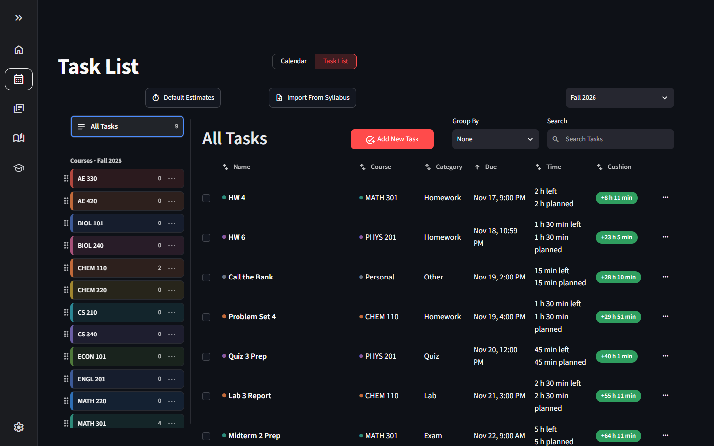
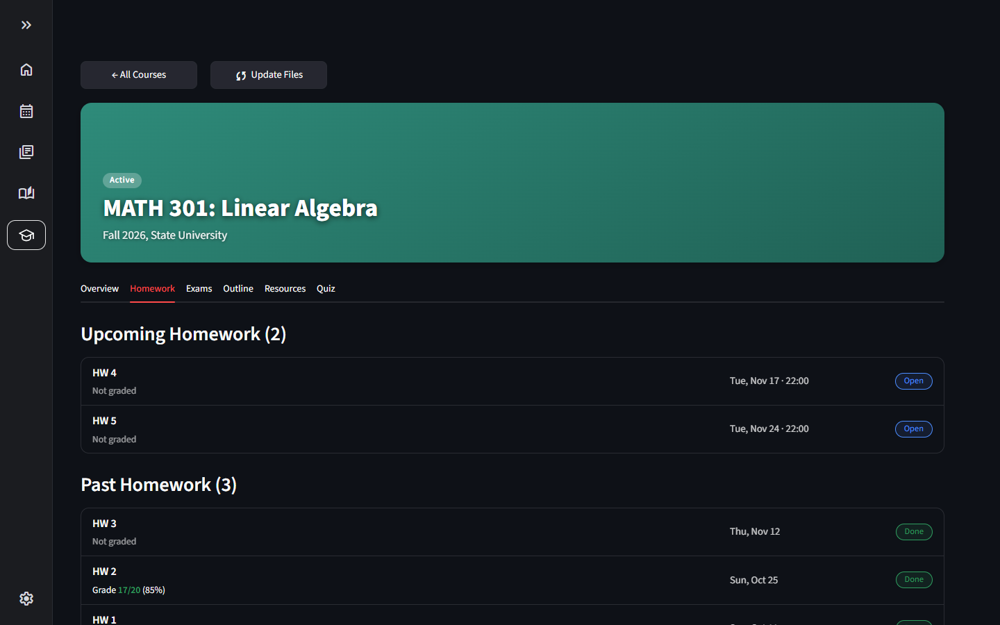

# Study Assistant

<b>Overview</b> &nbsp;|&nbsp; <a href="docs/INSTALL.md">Install</a> &nbsp;|&nbsp; <a href="docs/FILES.md">Your Files</a> &nbsp;|&nbsp; <a href="docs/SHORTCUTS.md">Shortcuts</a> &nbsp;|&nbsp; <a href="docs/HELP.md">Help</a> &nbsp;|&nbsp; <a href="CHANGELOG.md">Changelog</a>

---

Version 1.1.0. See the [changelog](CHANGELOG.md) for what changed in each release.

**A personal study desk for university coursework.** Keep a course's textbooks, lecture slides, notes, homework and exams in one library, read them side by
side, and let the app keep track of deadlines, grades and outlines. It runs entirely on your computer, in its own desktop window; nothing is sent anywhere.

## Main features

- **Course library.** Import PDFs and HTML pages (textbooks, lecture slides, notes, homework, exams, syllabi) and browse them by type or by course (tiles), by the day, month or year they were
  added (a timeline that folds), or by title, as cards, tiles or a details table. Add files one by one, from a zip (after a confirmation page), or by pressing Update to read the folder you keep them in. Imports are copies; your originals are never changed.
- **Note Reader.** Interactive HTML notes with tabs for the notes, mind map, equation sheet, assumptions, quiz and errata, next to a PDF window. Click an equation
  or a source line and the matching slide or textbook page opens.
- **PDF reader.** Single, double or continuous pages, zoom and drag to move, search, and pen or highlighter drawing that is saved with the file.
- **Homework and exams.** Written helper and grade-explanation pages shown beside the problem or graded paper, with Gradescope grade reports, exam preparation
  pages and a place for what is due.
- **Courses and outlines.** Each course has what is coming up, homework, exams, resources and a quiz; the All tab can also show the courses as a tree of knowledge, with similar fields on the same branch. The outline builds itself from the syllabus or the lecture titles and
  can be edited as plain text.
- **Calendar and Task List.** A weekly (or day, or month) schedule with your classes, activities, events, deadlines and study sessions; blocks of courses, tasks and activities on the left
  to drag into the schedule, with a menu to rename, color, hide or delete each one. The Task List page shows every task by course, grouped and sorted by any column, and **Import From
  Syllabus** reads the homework, quizzes and exams of each course of the term (from its course page and its syllabus) into the list, to check and change. Terms (semesters) are
  chosen and managed from the list above the calendar, and Home shows what is due next.
- **Study planner.** Tasks have a due date and a time estimate, and the Calendar shows how much free time is left before each deadline (a green, yellow or red cushion), warns when work does not fit, and
  places study sessions for you around classes, activities and events (with travel time); drag sessions and events to change them. Personal tasks can be planned in a break too.
- **Quizzes and eye rest.** Quizzes from your notes with scores kept per chapter, and a reminder to rest your eyes every 20 minutes.
- **Backup and moving.** Automatic snapshots, a library backup in a folder you choose, and Export My Files / Import to keep a copy or take everything to another
  computer.

## Gallery

(With made-up courses and files.)

<table>
  <tr>
    <td> <b>Home</b>: what is due next and the week of the term</td>
    <td> <b>Calendar</b>: classes, deadlines and study sessions, with your courses on the left</td>
  </tr>
  <tr>
    <td> <b>Task List</b>: every task by due date, category or course, with its cushion</td>
    <td> <b>Courses</b>: one card for each course, by status (or as a map of fields)</td>
  </tr>
  <tr>
    <td> <b>Course page</b>: what is coming up, grades, syllabus and understanding</td>
    <td> <b>Homework</b>: each problem set with its solution, graded paper and helper</td>
  </tr>
  <tr>
    <td> <b>Note Reader</b>: click an equation and its source slide opens beside the note</td>
    <td> <b>Library</b>: slides, notes and textbooks by type, course or date added</td>
  </tr>
  <tr>
    <td> <b>Course outline</b>: built from the syllabus or the lecture titles, and editable</td>
    <td> <b>Backup</b>: library backup, Export My Files and Import</td>
  </tr>
</table>

## Get it

- **Windows 10 and 11** and **macOS** (Apple silicon and Intel): download from the [Releases](https://github.com/Chiyami1213/study-assistant/releases) page and follow [Install](docs/INSTALL.md).
- Your antivirus, Windows SmartScreen or macOS may warn about the app: **Study Assistant does not contain a virus** (see the note on the Install tab).
- Problems, questions or ideas: the [Help](docs/HELP.md) tab, or Settings > Report an Issue inside the app.

## Help

Questions about installing, antivirus warnings, your files, backups, shortcuts and connection problems are answered on the [Help tab](docs/HELP.md).

## What's new

**1.1.0**
- **Study Assistant for macOS** (Apple silicon and Intel): a disk image to drag into Applications; files in `~/Library/Application Support/Study Assistant`.
- **New setup wizard** for Windows: sharp on high-resolution screens, with a welcome page, the choice to update, uninstall first or keep both when it finds an installed version,
  Desktop and Start menu shortcut options, an antivirus heads-up, and a last page with links to this page and its Help section.
- **Loading screen with a progress bar** from 0% to 100% that shows for at least two seconds.
- **Help and Report an Issue** in Settings; the report opens a ready-made GitHub issue.

The full history is in [CHANGELOG.md](CHANGELOG.md).
