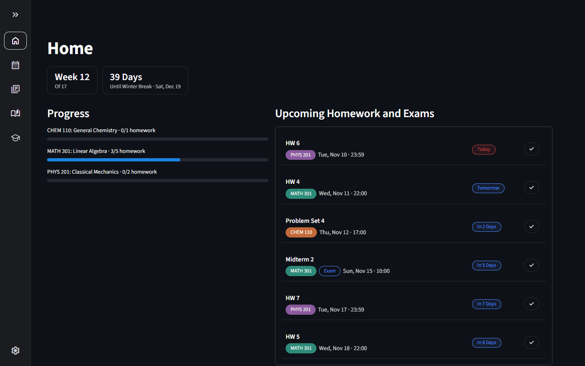
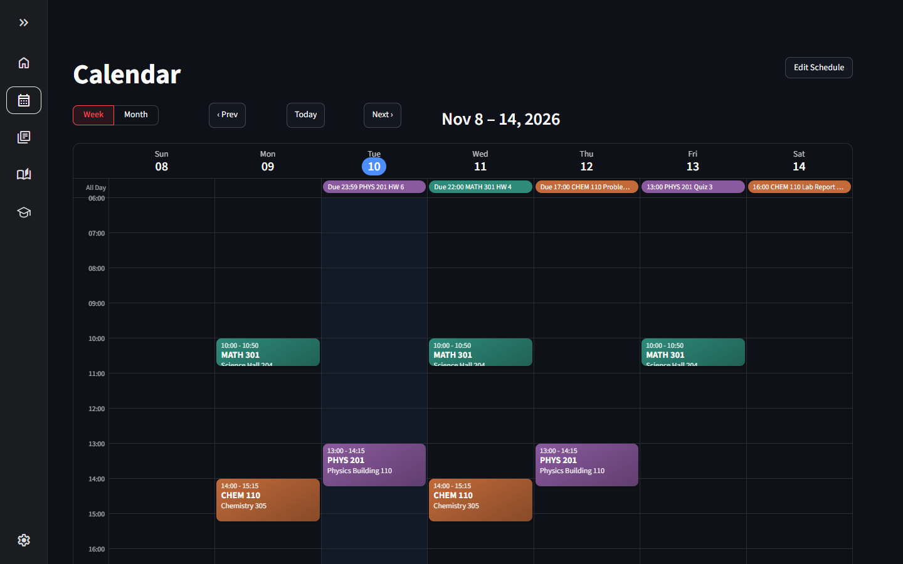
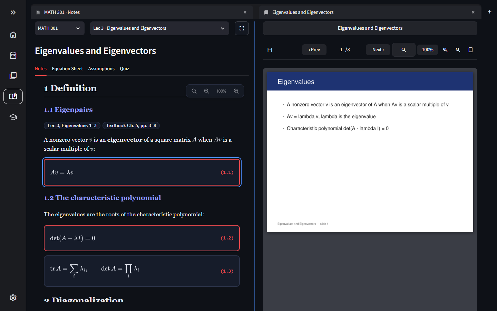
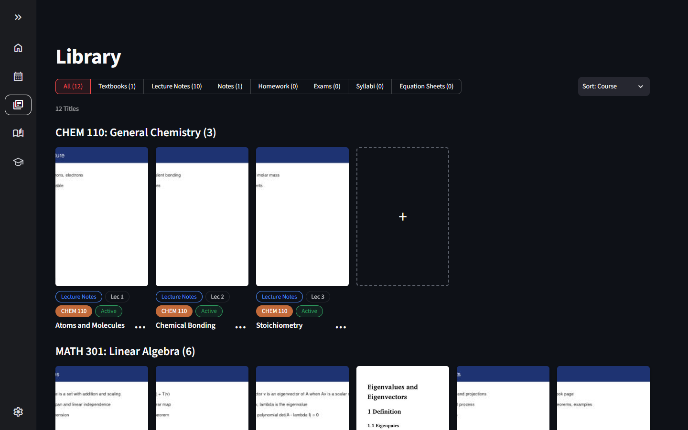
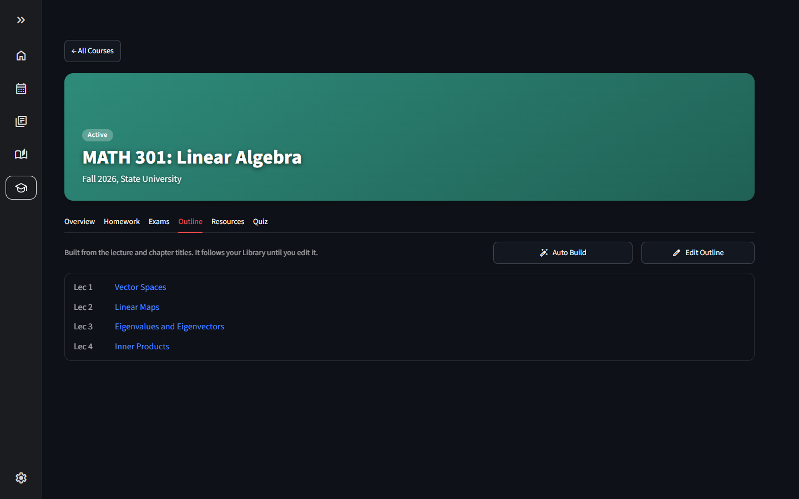
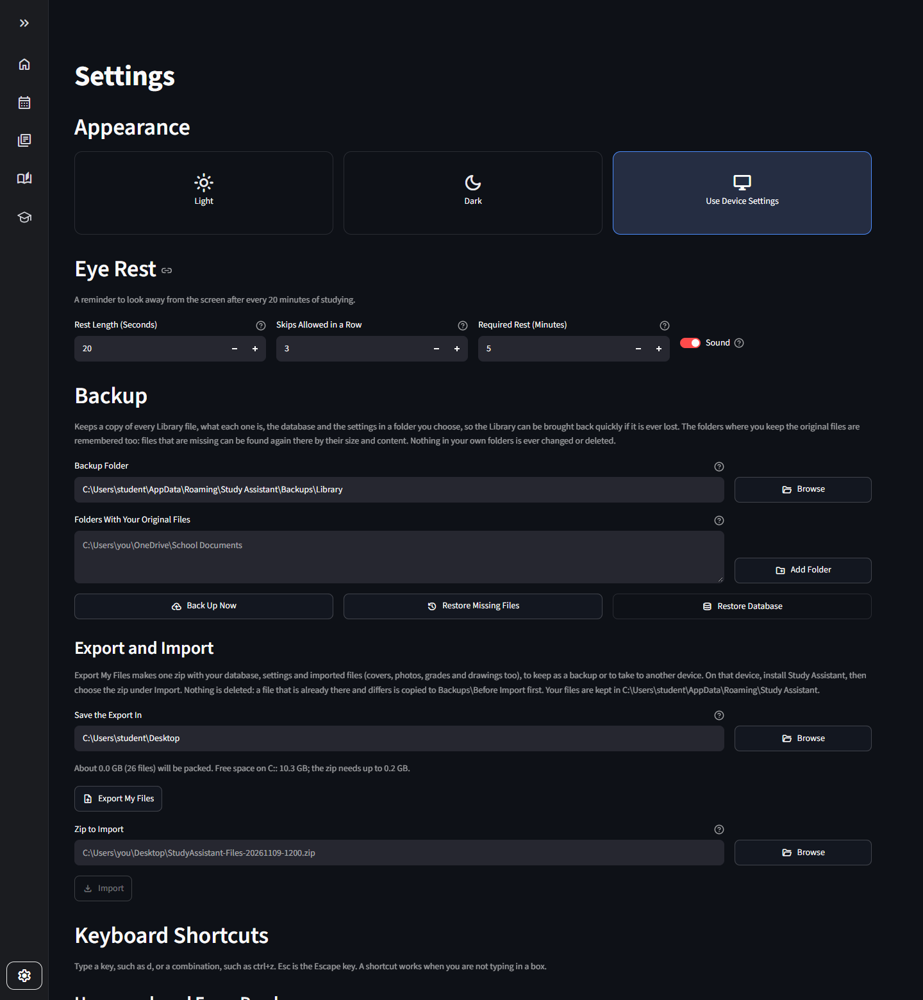

# Study Assistant

Version 1.0. See the [changelog](#changelog) below for what changed in each release.

**A personal study desk for university coursework.** Keep a course's textbooks, lecture slides, notes, homework and exams in one library, read them side by
side, and let the app keep track of deadlines, grades and outlines. It runs entirely on your computer, in its own desktop window; nothing is sent anywhere.

## Main features

- **Course library.** Import PDFs and HTML pages (textbooks, lecture slides, notes, homework, exams, syllabi) and sort them by course and lecture. Imports are copies;
  your originals are never changed.
- **Note Reader.** Interactive HTML notes with tabs for the notes, mind map, equation sheet, assumptions, quiz and errata, next to a PDF window. Click an equation
  or a source line and the matching slide or textbook page opens.
- **PDF reader.** Single, double or continuous pages, zoom and drag to move, search, and pen or highlighter drawing that is saved with the file.
- **Homework and exams.** Written helper and grade-explanation pages shown beside the problem or graded paper, with Gradescope grade reports, exam preparation
  pages and a place for what is due.
- **Courses and outlines.** Each course has deadlines, homework, exams, resources and a quiz. The outline builds itself from the syllabus or the lecture titles and
  can be edited as plain text.
- **Calendar and Home.** The weekly class schedule, holidays and exam period, and a Home page with what is due next and the week of the term.
- **Quizzes and eye rest.** Quizzes from your notes with scores kept per chapter, and a reminder to rest your eyes every 20 minutes.
- **Backup and moving.** Automatic snapshots, a library backup in a folder you choose, and Export My Files / Import to keep a copy or take everything to another
  computer.

## Screenshots

(With made-up courses and files.)

<table>
  <tr>
    <td> <b>Home</b>: what is due next and the week of the term</td>
    <td> <b>Calendar</b>: the class schedule with deadlines and exams</td>
  </tr>
  <tr>
    <td> <b>Note Reader</b>: click an equation and its source slide opens beside the note</td>
    <td> <b>Library</b>: slides, notes and textbooks sorted by course</td>
  </tr>
  <tr>
    <td> <b>Course outline</b>: built from the syllabus or the lecture titles, and editable</td>
    <td> <b>Backup</b>: library backup, Export My Files and Import</td>
  </tr>
</table>

## Download and install (Windows)

Download `StudyAssistant-1.0-Windows-Installer.zip` from the [Releases](../../releases) page, extract the whole zip, and run `Install Study Assistant.exe` from the
extracted folder (keep the `payload` folder next to it). It installs the app for your user only (no administrator needed), puts a shortcut on the desktop and
lists Study Assistant under Settings > Apps, where it can be uninstalled (your files are kept unless you choose to remove them). Windows 10 or 11 is needed.
The app starts empty; add your own courses and files.

> **Your antivirus or firewall may warn about the installer or the app, and may even call it malware.** This is a false alarm: the program is packaged with PyInstaller
> and is not code-signed, which security software often distrusts. If it blocks the file, choose "More info > Run anyway" (Windows SmartScreen), or allow / restore the file in
> your security software, and ignore the warning. Only download it from this page, and the whole source code is here to read.

## Where your files go

Everything you add (database, settings, imported PDFs and notes, covers, photos, drawings) is kept in `%APPDATA%\Study Assistant`, created empty on first run.
Imports are always copies; your original files are never changed or deleted.

## Backup and moving to another computer

Settings > Backup keeps a copy of your library in a folder you choose and can bring it back. **Export My Files** makes one zip with your database, settings and
imported files, to keep as a backup or to take to another computer: install Study Assistant there, open Settings > Backup > Import and choose the zip. Nothing is
deleted: a file that is already there and differs is copied aside first.

## Changelog

The full history is in [CHANGELOG.md](CHANGELOG.md).

**1.0**
- First release. Clean installs start empty; an installer that registers an uninstaller (keep or remove your files).
- Backup, Export My Files and Import, to protect your files and move them to another computer.
- Course outlines build themselves from the syllabus topics (or the Lec 0 slides), otherwise from the lecture or chapter titles, and can be edited as text.
- PDF reader zoom and pan in every view mode; equation and source-line clicks in the Note Reader open the matching slide or textbook page.
