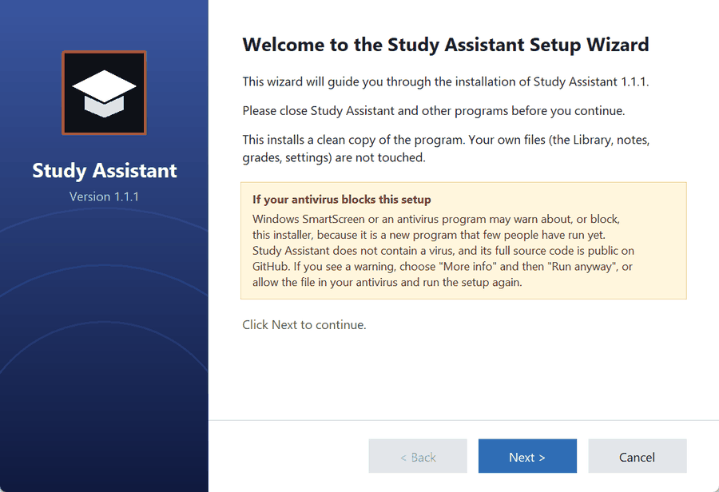
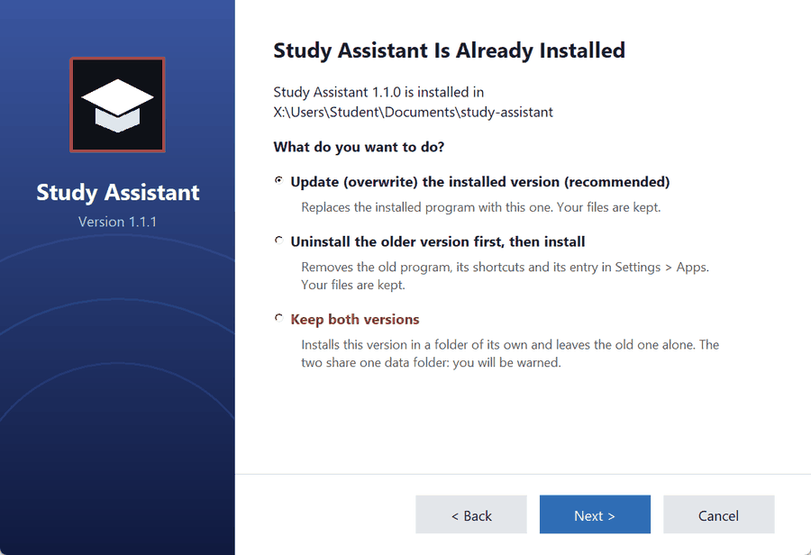
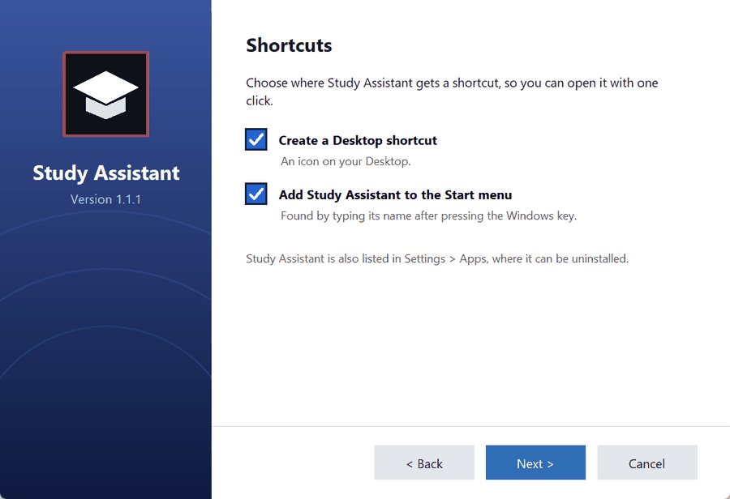
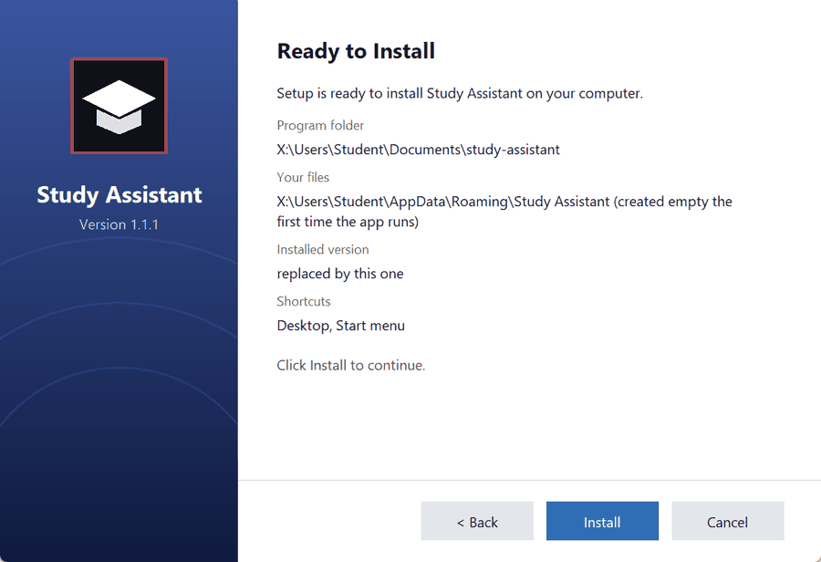
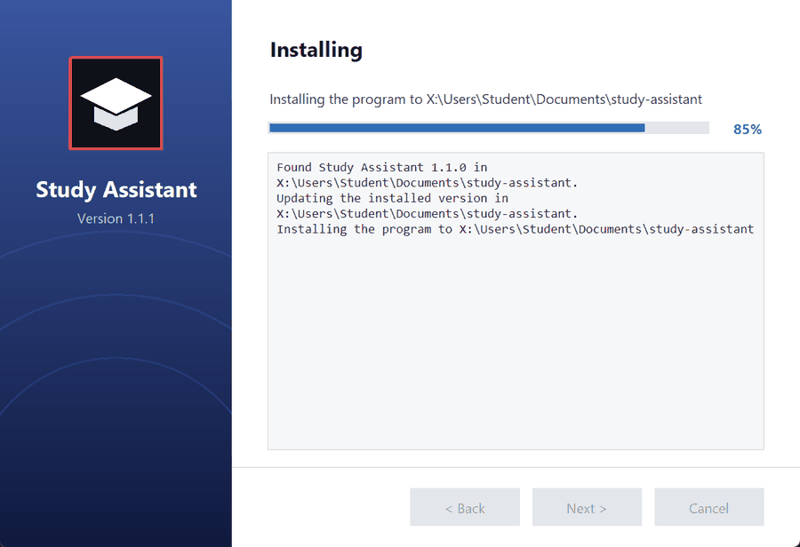
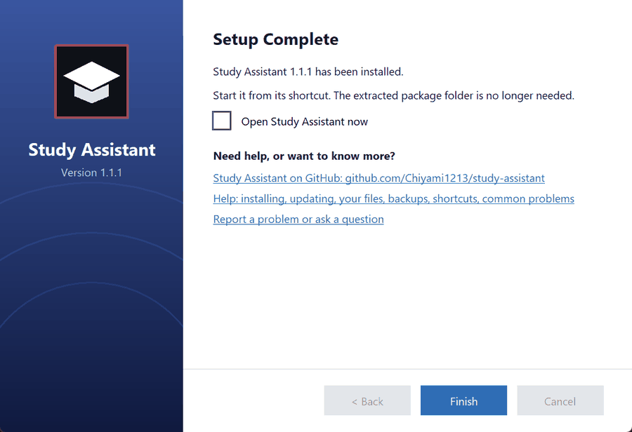

# Study Assistant: Install

<a href="../README.md">Overview</a> &nbsp;|&nbsp; <b>Install</b> &nbsp;|&nbsp; <a href="FILES.md">Your Files</a> &nbsp;|&nbsp; <a href="SHORTCUTS.md">Shortcuts</a> &nbsp;|&nbsp; <a href="HELP.md">Help</a> &nbsp;|&nbsp; <a href="../CHANGELOG.md">Changelog</a>

---

Study Assistant is installed for your user only (no administrator needed), and your files are kept apart from the program, so updating or reinstalling never touches them.
Everything is on the [Releases](https://github.com/Chiyami1213/study-assistant/releases) page.

## Choose Your Device

| Your computer | What to download | Steps |
|---|---|---|
| **Windows 10 or 11** (the native interface, version 1.2.0 and newer) | `StudyAssistant-Native-<version>-Windows-Installer.zip` (about 340 MB) | [Install on Windows](#install-on-windows-10-or-11) |
| **Windows 10 or 11** (the classic web interface, version 1.1.3) | `StudyAssistant-<version>-Windows-Installer.zip` from the [v1.1.3 release](https://github.com/Chiyami1213/study-assistant/releases/tag/v1.1.3) | [Install on Windows](#install-on-windows-10-or-11) |
| **Mac with Apple silicon** (M1, M2, M3, M4 or newer) | `StudyAssistant-<version>-macOS-Apple-Silicon.dmg` | [Install on a Mac](#install-on-a-mac) |
| **Mac with an Intel processor** | `StudyAssistant-<version>-macOS-Intel.dmg` | [Install on a Mac](#install-on-a-mac) |

Not sure which Mac you have? Click the Apple menu, then **About This Mac**. If it says **Chip: Apple M...**, choose Apple silicon; if it says **Processor: Intel ...**, choose Intel.

## Install on Windows 10 or 11

1. On the [Releases](https://github.com/Chiyami1213/study-assistant/releases) page, download `StudyAssistant-Native-<version>-Windows-Installer.zip` from the newest release (the steps are the same for the classic `StudyAssistant-<version>-Windows-Installer.zip` of version 1.1.3).
2. Extract the **whole** zip (right-click > Extract All) and open the extracted folder. Keep the `payload` folder next to `Install Study Assistant.exe`.
3. Run `Install Study Assistant.exe`. If Windows SmartScreen says it protected your PC, choose **More info > Run anyway** (see the note below).
4. Follow the setup wizard:
   - **If Study Assistant is already installed**, it tells you which version and offers to **update (overwrite)** it, to **uninstall the older version first**, or to **keep both**
     (it warns that both share one data folder and one address, so only one should be open at a time).
   - **Shortcuts:** you choose a Desktop shortcut and / or a Start menu entry. Study Assistant is also listed under Settings > Apps, where it can be uninstalled (your files are
     kept unless you choose to remove them).
   - The last page links to this page and its [Help](HELP.md) section.
5. Open Study Assistant from the shortcut or the Start menu.

### The setup wizard, page by page

The pictures show an update from an older version; on a first install the second page is left out.

**1. Welcome.** Press **Next**.

**2. Study Assistant is already installed** (only when an older version is found). **Update (overwrite)** is the recommended choice; your files are kept in every case.

**3. Shortcuts.** Choose a Desktop shortcut and / or a Start menu entry.

**4. Ready to install.** It lists where the program goes and where your files are kept. Press **Install**.

**5. Installing.** A progress bar shows the copying; it takes a minute or less.

**6. Setup complete.** Press **Finish**. The page also links to this Help section; tick **Open Study Assistant now** if you want it to start at once.

## Install on a Mac

1. On the [Releases](https://github.com/Chiyami1213/study-assistant/releases) page, download the `.dmg` for your Mac (see [Choose Your Device](#choose-your-device)) from the newest release.
2. Open the disk image and drag **Study Assistant** onto the **Applications** folder. If it is already there, choose **Replace** (your files are kept) or **Keep Both**.
3. The first time, right-click (or Control-click) the app in Applications, choose **Open**, then **Open** again. If macOS still blocks it, use System Settings > Privacy & Security >
   **Open Anyway** (see the note below).
4. The Mac app is built by GitHub from this repository (see `.github/workflows/build-macos.yml`). Your files are in `~/Library/Application Support/Study Assistant`.

> **Your antivirus, Windows SmartScreen or macOS may warn about the app, or block it.** It is a false alarm: **Study Assistant does not contain a virus**, and the whole source code
> is here to read. Programs that are new and not code-signed are often flagged until many people have run them. If it blocks the file, choose "More info > Run anyway"
> (Windows SmartScreen) or "Open Anyway" (macOS), or allow the file in your security software. Only download it from the [Releases](https://github.com/Chiyami1213/study-assistant/releases) page, and check the file against
> the SHA-256 checksum published next to it (`SHA256SUMS-Native.txt` for the native Windows zip, `SHA256SUMS.txt` for the classic one, `SHA256SUMS-macOS-Apple-Silicon.txt` or `SHA256SUMS-macOS-Intel.txt` for a Mac disk image): in PowerShell `Get-FileHash <file>`, on a Mac `shasum -a 256 <file>`.

The app starts empty; add your own courses and files.
